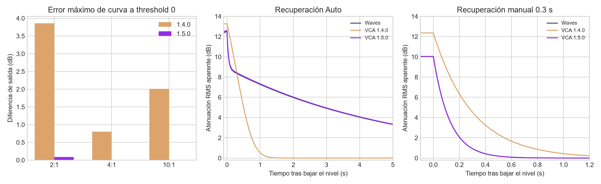

# Auditoría — VCA SSL 1.5.0

Creador: papielguapo. Windows x64, JUCE 9.0.5, Release, 15/11/2026.

## Resultado

Batería DSP aprobada: 11 817 257 comprobaciones, 22.68 s. Pluginval 1.0.4, strictness 10, semilla 671500, SUCCESS, código 0, sobre la copia instalada en Program Files/Common Files/VST3. Logs completos en Reference/Tests.txt y Reference/pluginval-level10.txt. El validador independiente del SDK VST3 no está configurado; auval no aplica a Windows. No se ha realizado escucha humana ni verificación del enrutamiento en cada DAW.

SHA256 del VST3 instalado y entregado: `5E72514F430A314F97D1F374BBAE252C4EA601BDE4D363BEB35B2E434E513E4E`.

## Sidechain sin cambios de skin

Entrada auxiliar mono/estéreo seleccionada automáticamente cuando el host activa el bus Sidechain. En ausencia de bus se usa el detector interno. Sidechain Source, disponible sólo en parámetros del host, permite Auto (predeterminado), Internal o External. External sin señal detecta silencio; no vuelve a la entrada principal. SC FILTER actúa sobre el detector elegido. La señal auxiliar nunca se suma al audio.

Pruebas de bus mono/estéreo, selección automática, override Internal, auxiliar silencioso con entrada principal fuerte y auxiliar fuerte con entrada principal silenciosa. Los índices anteriores se conservan y el selector se añade al final. Skin y etapa HarmonicStage.h sin cambios respecto a 1.4.0.

## Dinámica frente a SSLComp

Calibración numérica independiente con 191 renders de SSLComp 14.12.90.381. Curvas estáticas interpoladas por umbral, ratio, ataque y release. Auto con recuperación rápida y memoria lenta; releases manuales recalibrados. No contiene código Waves ni depende de su instalación.

En los ocho niveles a 1 kHz, threshold 0, ataque 10 ms y Auto, error máximo frente a Waves: 2:1 0.084 dB; 4:1 0.0015 dB; 10:1 0.0006 dB. Son puntos de calibración, no una garantía general. En el escalón medido, error medio Auto baja de 4.163 a 0.063 dB y manual de 0.748 a 0.0026 dB.

Validación independiente: niveles intermedios con ratio 4 y tres umbrales, error máximo 0.086 dB. Ráfagas no utilizadas en ajuste: error medio 0.005–0.040 dB; el ataque de 0.1 ms conserva un pico de diferencia de 3.27 dB en ventana de 1 ms. Con compresión a otras frecuencias se observan diferencias de hasta 1.27 dB. La interpolación matemática en otros ajustes también conserva errores próximos a 0.86 dB. No es una reproducción sonora 1:1.

En dos fragmentos musicales la correlación tras ajuste constante de volumen mejora: batería 0.99982 y bus 0.99943. La diferencia de RMS sin igualar baja de 1.699 a 0.583 dB en batería, pero sube de 0.293 a 0.796 dB en bus: la mejora no es uniforme. Los fragmentos no se publican en GitHub.

## Audio conservado

KI eliminado. Etapa H2/H3 4× sin cambios: H2 −59.9956 dBc, H3 −73.975 dBc; productos plegados del ensayo de 18 kHz −150.698 y −155.478 dBc. No se inyecta ruido. Ganancia del ruido bajo de entrada: −0.000285 dB en el ensayo. No implica ausencia de intermodulación con música ni sólo dos productos en cualquier señal.

Latencia real declarada tras preparación: 64 samples; rutas dry y bypass alineadas. FIX conserva el detector y equipara RMS, con error inferior a 0.003 dB en los ensayos. Pruebas de silencio, automatización, estados, bloques variables y tasas de 8–384 kHz, entradas NaN/Inf/extremas. Apertura mínima 817 × 126 conservada.

[Mediciones](Reference/Validacion-dinamica.json) · [Calibración](Reference/ModelCalibration.json)

