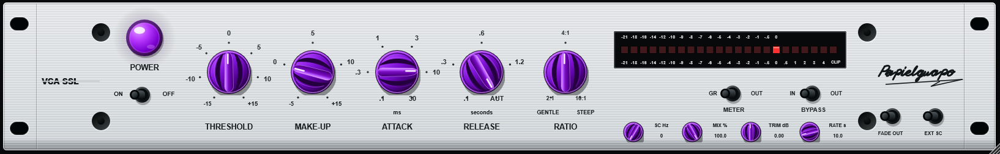

# VCA SSL COMPRESSOR — papielguapo

**Creador: [papielguapo](https://github.com/papielguapo)**



[Descargar para Windows x64: VST3, Standalone y código](https://github.com/papielguapo/VCASSL/releases/latest)

Compresor VCA de bus basado en el frontal vectorial de [FET67](https://github.com/papielguapo/FET67). Panel de aluminio, mandos violetas, piloto, firma y lienzo 1634 × 252, con escala del 50 al 250 %. **Siempre se abre al mínimo: 817 × 126 (50 %), también al reabrir el editor o cargar sesiones antiguas.** Se puede ampliar durante el uso.

## Controles actuales — 1.5.0

- Threshold −15…+15 dB; Make-Up −5…+15 dB.
- Attack 0.1/0.3/1/3/10/30 ms; Release 0.1/0.3/0.6/1.2 s/Auto; Ratio 2/4/10.
- POWER enciende/apaga el procesamiento; apagado entrega señal seca. El bypass del DAW también sigue disponible.
- SC FILTER, a la izquierda de METER, activa un pasa-altos de 80 Hz **sólo en el detector**. Reduce la influencia del bombo/subgrave en la compresión sin ecualizar el audio. ON/OFF suavizado; piloto morado pequeño encendido en ON. Apagado por defecto.
- METER alterna GR y OUT. OUT conserva la referencia RMS original: 0 = −18 dBFS RMS. No es un medidor true peak.
- FIX iguala el RMS final de salida al RMS original de entrada para comparar al mismo volumen. No modifica el detector ni la señal de entrada. Apagado por defecto.

Doble clic restaura valores y el popup indica el ajuste. Sin botón Analog ni ruido generado.

## Dinámica recalibrada — 1.5.0

Se han medido curvas de SSLComp para las 30 combinaciones Attack/Release y los tres ratios, y una malla de umbral entre −15 y +15 dB. La calibración numérica queda integrada en C++ con interpolación monótona; no se copia código de Waves. Auto combina una recuperación rápida de unos 43–45 ms con una memoria lenta de unos 5.1 s, cuya carga depende de la duración y nivel previos. Los controles conservan las etiquetas nominales de la referencia.

Es una aproximación medida, no una reproducción certificada 1:1. Las tablas están calibradas principalmente con tonos de 1 kHz a 48 kHz; la respuesta con música, otras frecuencias y transitorios muy rápidos puede diferir. Se adjuntan resultados y límites en la auditoría. La etapa H2/H3 de 1.4.0 se conserva sin cambios.

## Sidechain externo sin cambios en la skin

Enruta la señal de control a la entrada auxiliar **Sidechain** del VST3 y actívala en el DAW. Con la fuente en **Auto** (valor inicial), el compresor usa ese bus cuando el host lo activa; si está desactivado usa la entrada principal. El sidechain controla la compresión y nunca se mezcla con la salida. SC FILTER aplica sus 80 Hz al detector seleccionado.

El parámetro **Sidechain Source** aparece sólo en los parámetros del host/automatización: Auto, Internal y External. Permite forzar Internal en hosts que mantengan el bus auxiliar siempre activo. External fuerza el detector auxiliar y recibe silencio si no hay bus/señal; no vuelve automáticamente a la entrada principal durante los huecos de una señal de sidechain. No se añade ningún control al frontal. El parámetro externo legado se conserva por compatibilidad, pero no es necesario activarlo.

## Armónicos limpios H2/H3 — 1.4.0

KI y su filtro de 18 Hz se han eliminado del audio. La nueva etapa añade un componente de segundo y tercer orden, sin controles nuevos, generador de ruido, saturación adicional ni ecualización de la señal limpia. El color es moderado: objetivos de referencia a 1 kHz y pico 0.2 de aproximadamente −60 dBc en H2 y −74 dBc en H3.

Se procesa sólo el componente añadido con interpolación/filtrado 4× y polinomio de grado tres: `0.01*x*x - 0.02*x*x*x`. La ruta limpia se conserva y se retrasa para alinearla, sin pasarla por el filtro antialias. Se elimina DC sólo del componente añadido mediante un bloqueador a 1 Hz; no hay pasa-altos de 18 Hz sobre el audio. Se mantienen SC FILTER, FIX y el compresor VCA.

El sobremuestreo introduce **64 samples de latencia**, declarados al host y alineados también en mezcla y bypass. A 48 kHz son 1.33 ms. El polinomio da H2/H3 en un tono simple dentro del rango normal, pero cualquier no linealidad puede producir intermodulación con señales complejas. No se promete ausencia matemática de otros productos sobre toda señal. La protección numérica sólo acota el componente añadido por encima de +6 dBFS; no recorta la señal limpia.

## FIX

RMS sin ponderación, integración de 400 ms, adaptación de 750 ms y transición ON/OFF de 50 ms. Referencia: canal de mayor RMS, con corrección común L/R. Límite ±24 dB; la corrección se congela cuando entrada o salida quedan por debajo de −70 dBFS RMS. Necesita unos segundos de estabilización. Iguala RMS, no LUFS, y no garantiza picos por debajo de 0 dBFS. Compensa también Make-Up y Trim. No añade ruido ni limitador.

## DSP y compatibilidad

Detector híbrido pico/RMS corto enlazado en estéreo, con calibración estática por ratio, ataque, release y umbral. Auto utiliza una recuperación rápida y una memoria lenta dependiente del programa; los releases manuales y sus ataques se han ajustado con mediciones de SSLComp. Referencia de rangos: [manual de Waves](https://assets.wavescdn.com/pdf/plugins/ssl-g-master-buss-compressor.pdf). Modelo independiente sin afiliación Waves/SSL ni equivalencia sonora 1:1. La auditoría 1.5.0 incluye nuevas mediciones comparativas y sus límites; los archivos SSLComp-4.txt y vca-transfer.txt son históricos.

Latencia declarada de 64 samples; cola conservadora de dos segundos para la eliminación de DC del componente añadido. Protección de entradas NaN/Inf y amplitudes absurdas mayores de ±1 000 000 (+120 dBFS), sin limitación de picos musicales normal. Parámetros antiguos de Mix/Trim/Fade se conservan para sesiones y automatización existentes, neutros en estados nuevos. El selector nuevo Sidechain Source se añade al final de la lista para conservar los índices anteriores. El parámetro legado KI se conserva pero se ignora: ya no existe esa etapa. El antiguo valor numérico de SC Filter se conserva por compatibilidad pero el interruptor actual utiliza 80 Hz fijos.

## Instalación y compilación

Copiar la carpeta completa `Binaries/VCA SSL.vst3` a `C:/Program Files/Common Files/VST3` (puede requerir administrador), y volver a escanear el DAW. `Binaries/VCA SSL.exe` es Standalone. Fabricante Papi, plugin VcSL, bundle com.papielguapo.vcassl. No sustituye FET67.

C++17, JUCE 9.0.5 y Visual Studio con C++/Windows SDK. CMake usa C:/JUCE o descarga JUCE. Respetar la licencia JUCE correspondiente a la distribución.

```powershell
cmake -S . -B build -G "Visual Studio 18 2026" -A x64 -DVCASSL_COPY_PLUGIN_AFTER_BUILD=OFF
cmake --build build --config Release --parallel 4
ctest --test-dir build -C Release --output-on-failure
```

[Informe de auditoría](Auditoria.md) · [Log pluginval nivel 10](Reference/pluginval-level10.txt) · [Pruebas DSP](Reference/Tests.txt).


