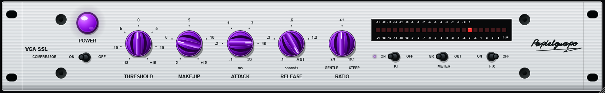

# VCA SSL — papielguapo

**Creador: [papielguapo](https://github.com/papielguapo)**


[Descargar VCA SSL para Windows x64 (VST3 + Standalone + código)](https://github.com/papielguapo/VCASSL/releases/latest)

Compresor de bus VCA original basado en el frontal vectorial de [FET67](https://github.com/papielguapo/FET67). Conserva el panel de aluminio, mandos violetas, piloto, firma, tornillos, medidor y lienzo 1634 × 252. Cambian nombre, escalas y funciones; los controles adicionales son necesarios para cubrir la referencia.

## Controles

El frontal contiene únicamente Threshold −15…+15 dBu, Make-Up −5…+15 dB, Attack 0.1/0.3/1/3/10/30 ms, Release 0.1/0.3/0.6/1.2 s/Auto y Ratio 2/4/10. POWER enciende/apaga el procesamiento, METER alterna GR/OUT y FIX iguala automáticamente el RMS de salida al RMS original de entrada. KI, a la izquierda de METER, activa el color armónico y su piloto morado pequeño. Sin modo Analog ni ruido añadido. Doble clic restaura el valor inicial y el popup indica el valor exacto.

Se han retirado del frontal BYPASS, FADE, EXT SC y la fila SC Hz / MIX / TRIM / RATE. Los parámetros internos se conservan para compatibilidad con sesiones y automatización anteriores; en un estado nuevo están neutros: SC Off, Mix 100%, Trim 0 dB, Fade Off y detector interno. El bypass del DAW sigue disponible.

Referencia de rangos: [manual oficial Waves](https://assets.wavescdn.com/pdf/plugins/ssl-g-master-buss-compressor.pdf). No incluye código, recursos ni presets de Waves. Modelo propio, sin afiliación ni certificación Waves/SSL. No se afirma equivalencia sonora 1:1. Auto, knee y autofade son implementaciones propias; se ha medido SSLComp Stereo V14.12 instalado para aproximar la calibración del detector, con Analog Off. El control Fade es de dos estados, sin el tercer estado de cancelación descrito en su manual.

## DSP

Detector de pico feed-forward, enlace estéreo permanente y misma ganancia en ambos canales. Calibración del detector +24.1 dB respecto a dBFS pico, ajustada con senoidal de 1 kHz frente a SSLComp V14.12, threshold 0, ratio 4:1, ataque 10 ms y release Auto. Rodilla suave 6/3/1 dB para ratio 2/4/10. Attack y Release son constantes de tiempo exponenciales del control de ganancia; Auto depende de la historia del nivel. El filtro pasa-altos sólo afecta al detector. Sin limitador oculto, sin ganancia automática, sin latencia. Con KI apagado la etapa de ganancia es limpia. OUT conserva el medidor RMS original (0 = −18 dBFS RMS); GR conserva la escala LED original hasta 21 dB.

## Windows x64

Copiar la carpeta completa `Binaries/VCA SSL.vst3` al directorio VST3 del DAW. `Binaries/VCA SSL.exe` es Standalone. Identificador propio `VcSL`, bundle `com.papielguapo.vcassl`: no sustituye FET67 ni carga sus estados. No se instala automáticamente.

## Compilar

C++17, JUCE y Visual Studio con C++/Windows SDK. CMake utiliza C:/JUCE o descarga JUCE 9.0.5. Respetar la licencia JUCE correspondiente al uso y distribución.

```powershell
cmake -S . -B build -G "Visual Studio 18 2026" -A x64 -DVCASSL_COPY_PLUGIN_AFTER_BUILD=OFF
cmake --build build --config Release --parallel 4
ctest --test-dir build -C Release --output-on-failure
```

Pruebas offline incluidas en Tests. No se ha validado una matriz de DAWs ni se ha realizado comparación auditiva. La medición de referencia incluida cubre una curva estática y una traza de transitorio, no todos los ajustes. Las constantes nominales no garantizan transitorios idénticos a hardware u otros plugins.

## FIX — comparación al mismo volumen

FIX se encuentra en la antigua posición de BYPASS. Apagado por defecto. Compensa únicamente la ganancia de salida para igualar el RMS de la señal original de entrada: no normaliza ni modifica la entrada, el umbral, el detector ni la reducción de ganancia. Así permite comparar con POWER apagado o con el bypass del DAW sin favorecer la opción más fuerte.

Se utiliza RMS sin ponderación, con integración exponencial de 400 ms, adaptación de ganancia de 750 ms y transición de encendido/apagado de 50 ms. La referencia es el canal con mayor RMS, compartiendo la misma corrección entre L/R para conservar el balance estéreo. Ajuste máximo ±24 dB; por debajo de −70 dBFS RMS de entrada o salida se congela la corrección para evitar amplificar silencios. La igualación tarda unos segundos en estabilizarse y aproxima volumen RMS, no sonoridad perceptual LUFS. FIX no añade ruido, saturación, limitador ni latencia. Make-Up y Trim quedan compensados por FIX; desactívalo para juzgar su cambio de volumen. El fade heredado se aplica después de FIX.

## KI — armónicos como en PWM TONE BOY

Interruptor a la izquierda de METER, con pequeño piloto morado encendido cuando KI está en ON. Apagado por defecto e independiente de FIX. Reutiliza la función de segundo armónico de PWM TONE BOY: `x + k2*x*x/(1 + 0.25*x*x)`, con intensidad `0.008 + 0.012*(1-g)` dependiente de la reducción de ganancia y atenuación a niveles muy bajos. Se aplica tras la reducción VCA, antes de Make-Up y de FIX. No modifica el detector ni genera ruido.

Incluye el filtro infrasonoro Butterworth de cuarto orden a 18 Hz, con estados y coeficientes en doble precisión. Sólo afecta a la ruta KI; apagado recupera exactamente la ruta limpia tras una transición de 20 ms. Se han adaptado la envolvente de nivel y el enlace al VCA: la transferencia armónica y el filtro proceden de PWM, pero no se copia su cadena completa de PWM/DAC/EQ. Esta versión no utiliza el sobremuestreo 4× de PWM TONE BOY; el contenido armónico de alta frecuencia puede producir aliasing. El filtro puede dejar una breve cola tras señales previas; desde reposo no produce señal ni ruido.



## Auditoría 1.2.1

**Pluginval 1.0.4 nivel 10: SUCCESS**, sobre el VST3 instalado en Windows, con GUI y automatización. Pruebas DSP y regresiones de robustez aprobadas. Corregidas las entradas numéricas extremas, la cola declarada de KI y la precisión de FIX. Skin con COMPRESSOR bajo VCA SSL. [Informe y límites de la auditoría](Auditoria.md) · [Log completo de pluginval](Reference/pluginval-level10.txt).
